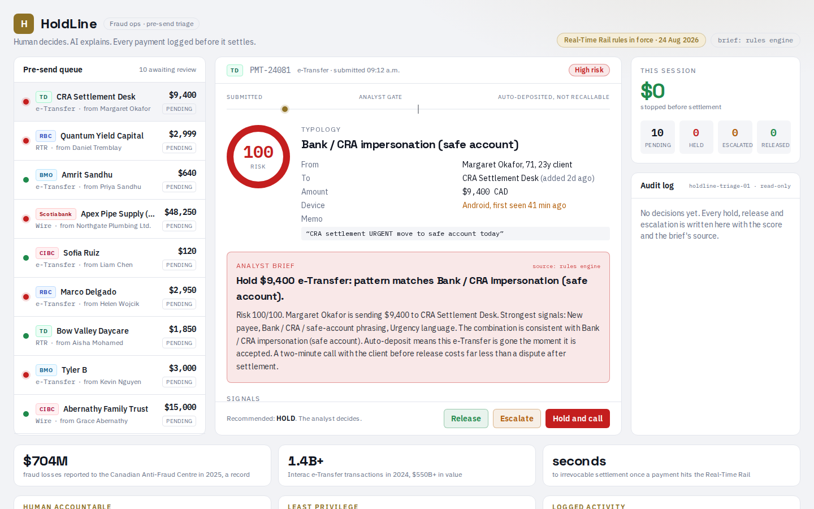

# HoldLine

**Pre-send fraud triage for Canadian real-time payments.**
_Human decides. AI explains. Every payment logged before it settles._

HoldLine is a bank-side console that sits in front of the payment rail, not behind it. It scores every outbound Interac e-Transfer, Real-Time Rail (RTR) and wire payment before it leaves the bank, tells a fraud analyst **why** it looks wrong in plain English, and records the human decision (Hold, Release, Escalate) in an immutable audit log.

**Live demo:** {{DEPLOY_URL}}



---

## Why now

- **Payments Canada's Real-Time Rail By-law and RTR Rules came into force on 24 August 2026.** RTR payments clear in seconds and are **irrevocable**. Once the money moves, there is no chargeback and no recall window, so every meaningful fraud control has to move upstream, into the seconds *before* the payment is released.
- **Interac e-Transfer carried 1.4B+ transactions and $550B+ in value in 2024.** The volume that now becomes near-instant and final is not a niche.
- **2025 was Canada's worst fraud year on record:** the Canadian Anti-Fraud Centre logged **$704M** in reported losses, up from $638M in 2024, and the CAFC itself estimates it captures only a small fraction (roughly 5 to 10 percent) of what actually happens.
- **Induced and misdirected transfers are the everyday case, not the exotic one.** Industry estimates put roughly 1.2 million Canadians sending an e-Transfer to the wrong recipient in 2024, average loss around $890.
- **Every Big 5 bank's 2026 AI headline is an employee-facing tool** (RBC Assist, TD's Layer 6 agentic underwriting memo that took pre-adjudication from about 15 hours to under 3 minutes, BMO Lumi Assistant, Scotia Navigator and Scotia Intelligence, CIBC's AI 2.0 agentic workspace). Fraud operations is the obvious next desk. HoldLine is that desk's tool.

The window between "customer hits send" and "money is gone forever" used to be days. On the RTR it is roughly one second. HoldLine is what you put in that second.

---

## What it does

- **Queue (left column).** Ten pending outbound payments across five ledgers (RBC, TD, BMO, Scotiabank, CIBC) with amount, payee, channel (e-Transfer / RTR / wire), a status pill (pending / held / released) and a rules-based risk dot, so the three genuinely dangerous rows are visibly red before the analyst clicks anything.
- **Verdict card (centre).** For the selected payment: a 0 to 100 risk score ring (green under 40, amber 40 to 69, red 70 and above), a **scam typology badge** (bank or CRA impersonation "safe account" scam, romance and investment, invoice redirection, mule split under limit, benign), **signal chips** showing exactly which factors fired, a recommended action (Hold and call customer / Release / Escalate), a **ready-to-read customer call script**, and Hold / Release / Escalate buttons.
- **Provenance tag.** Every analyst brief is stamped `source: model` or `source: rules`, so the analyst always knows whether they are reading a language model's summary or the deterministic engine's output. No silent AI.
- **Metrics and audit log (right column).** Live counts of pending, held and released payments plus dollars protected this session, and a reverse-chronological audit log capturing `{ time, analyst, payment id, decision, score, source }` for every action taken.
- **Governance footer.** Three principle cards (a human stays accountable for material decisions, the agent runs on a least-privilege identity, all agent activity is logged) written against **OSFI's 2026 expectations** for AI and agent use in federally regulated financial institutions.

The AI never moves money. It ranks, explains and drafts. A person presses the button, and the press is what gets logged.

---

## How the risk engine works

The scorer is deterministic and lives in `src/lib/rules.ts`. It is pure TypeScript, has no network dependency, and runs identically on every machine. That matters for a control that has to be explainable to a regulator.

| Signal | Condition | Weight |
| --- | --- | ---: |
| New payee | Payee added less than 7 days ago | +30 |
| Bank / CRA / "safe account" language | Memo mentions a bank, the CRA, or moving funds to a "safe account" | +30 |
| Urgency keywords | Memo contains urgency or secrecy cues (urgent, immediately, do not tell) | +20 |
| Large amount | Amount greater than or equal to $5,000 | +15 |
| New device | Session originates from an unrecognized device | +15 |
| Velocity | 3 or more transfers in the trailing 24 hours | +10 |
| Off-hours | Sent outside normal banking hours | +5 |

Scores are summed and **capped at 100**. Bands: **green** under 40, **amber** 40 to 69, **red** 70 and above. The fired signals are surfaced as chips on the verdict card, so the score is never a black box number: the analyst sees the arithmetic.

---

## Optional LLM brief

The language model is an **explainer, not a decider**. It writes the analyst brief and the customer call script from the signals the rules engine already produced.

- Endpoint: `src/app/api/triage/route.ts`
- Provider chain, tried in order: **Anthropic** (`ANTHROPIC_API_KEY`), then **Groq** (`GROQ_API_KEY`), then **Gemini** (`GEMINI_API_KEY`), then a **built-in deterministic template**.
- **All three keys are optional.** With zero keys configured the app runs completely: same scores, same typologies, same call scripts, generated from the template. The verdict card simply reads `source: rules`.

```bash
ANTHROPIC_API_KEY=      # optional
GROQ_API_KEY=           # optional
GEMINI_API_KEY=         # optional
```

Graceful degradation is a deliberate design choice, not a fallback of last resort. A fraud control that stops working when a vendor API has an outage is not a control.

---

## Run locally

```bash
npm install
cp .env.example .env
npm run dev
```

Open http://localhost:3000. No keys required.

---

## Stack

- **Next.js 16** (App Router) with **React 19**
- **TypeScript**, strict mode, no `any`
- **Tailwind CSS v4**, dark navy enterprise theme
- **Vercel** for deployment
- Optional: `@anthropic-ai/sdk`, Groq API, Google Gemini API

---

## Disclaimer

All data in HoldLine is **synthetic**. Payments, payees, memos, devices and analysts are fabricated for demonstration. HoldLine does not connect to any real bank system, payment rail, or customer record, and it moves no money.

Bank names (RBC, TD, BMO, Scotiabank, CIBC) and network names (Interac e-Transfer, Real-Time Rail) are used descriptively to illustrate a multi-ledger fraud queue. HoldLine is an independent project and is **not affiliated with, endorsed by, or connected to** any of these institutions, Payments Canada, Interac Corp., the Canadian Anti-Fraud Centre, or OSFI. Regulatory references describe publicly stated expectations and are not legal advice.

Built by Marco Ayuste for the INSPIRE Hackathon, August 2026.
